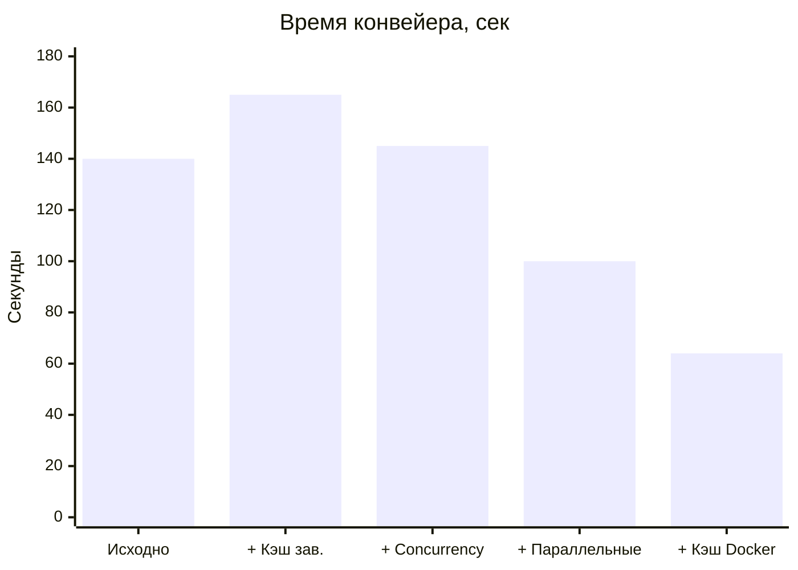

# Оптимизация конвейера CI

## Цель
Снизить время прохождения пайплайна (Continuous Integration) и определить его критический путь с помощью методов оптимизации из Лекции 4.

## Исходные данные
Репозиторий с проектом на Laravel (CRM для экскурсий), база данных MySQL, фронтенд на Vite. 
Замеры времени производились в GitHub Actions. Для получения объективных данных вычислялась медиана по нескольким запускам.

## Ход выполнения

### 1. Базовая линия (Baseline)
На старте конвейер выполнял все этапы последовательно в одном Job (установка зависимостей -> линтер -> тесты -> сборка Docker-образа).

**Результаты 5 замеров (сек):** 125, 127, 154, 161, 140.
**Медиана базовой линии:** 140 секунд (2 мин 20 с).

**Критический путь базовой линии:** 
Самым долгим этапом была сборка Docker-образа (около 90 секунд), так как Docker скачивал базовые слои Ubuntu и устанавливал PHP-пакеты с нуля. Тесты и линтер выполнялись строго после сборки, увеличивая общее время.

### 2. Применённые оптимизации
Мы последовательно применили 4 оптимизации, рекомендованные в лекции:

1. **Кэширование зависимостей Composer и NPM**
   С помощью `actions/cache` и встроенного кэша в `setup-node`. 
   *Результат (медиана):* 165 секунд. Кэш сэкономил время на установке пакетов, но общее время не упало, так как критический путь сместился в сторону Docker. (Погрешность связана с выделением разных серверов GitHub).

2. **Отмена устаревших запусков (Concurrency)**
   Добавлен блок `concurrency`. Если разработчик пушит новый коммит, пока предыдущий CI еще работает, старый запуск отменяется.
   *Результат (медиана):* 145 секунд. Время самих сборок не изменилось, но мы защитили систему от «зависших» параллельных процессов.

3. **Фильтры путей (Path filters)**
   В блок `on: pull_request: paths:` добавлены только те файлы, от которых зависит код. 
   *Результат:* CI не запускается при изменении только документации (экономия 100% времени).

4. **Параллельные Job и Кэш Docker**
   Мы разделили конвейер на два независимых параллельных процесса (`tests` и `docker`) и добавили `docker/build-push-action` с кэшированием слоев (Buildx).
   *Результат (медиана по 3 замерам):* **64 секунды**. Сборка Docker-образа теперь занимает 32 секунды (вместо 90), а тесты идут одновременно с ней.

### 3. Итоговая таблица «До / После»

| Этап | Время (сек) | Изменение | Комментарий |
|---|---|---|---|
| Исходно | 140 | — | Базовая линия (медиана) |
| + Кэш зависимостей | 165 | +25 | Composer и NPM из кэша, но уперлись в Docker |
| + Concurrency | 145 | -20 | Отмена параллельных запусков |
| + Параллельные Job | 100 | -45 | Docker и тесты идут одновременно |
| **+ Кэш Docker** | **64** | **-36** | Docker слои из кэша, сборка за 32с |

### 4. Диаграмма «До / После»
На графике показано, как последовательное применение оптимизаций повлияло на общее время конвейера. Благодаря параллельным Job и кэшу Docker-слоев, время сократилось более чем в 2 раза.

## Выводы

Критический путь после всех оптимизаций сместился. Теперь основное время занимает инициализация MySQL и выполнение самих тестов (около 40-50 секунд), а также шаги Setup PHP. Сборка Docker больше не является узким горлышком.

*   Применение кэша Docker-слоев дало колоссальный прирост: сборка образа сократилась с **90 до 32 секунд**.
*   Благодаря параллельным Job, тесты выполняются одновременно со сборкой Docker, поэтому общее время конвейера равно времени выполнения самой долгой ветки (тесты).
*   Фильтры путей позволяют экономить **100% времени** на PR, связанных только с документацией (например, обновление README.md).

## Итог

Конвейер настроен, базовая линия зафиксирована. Время сборки оптимизировано с **140 до 64 секунд** (ускорение в **2.1 раза**).
