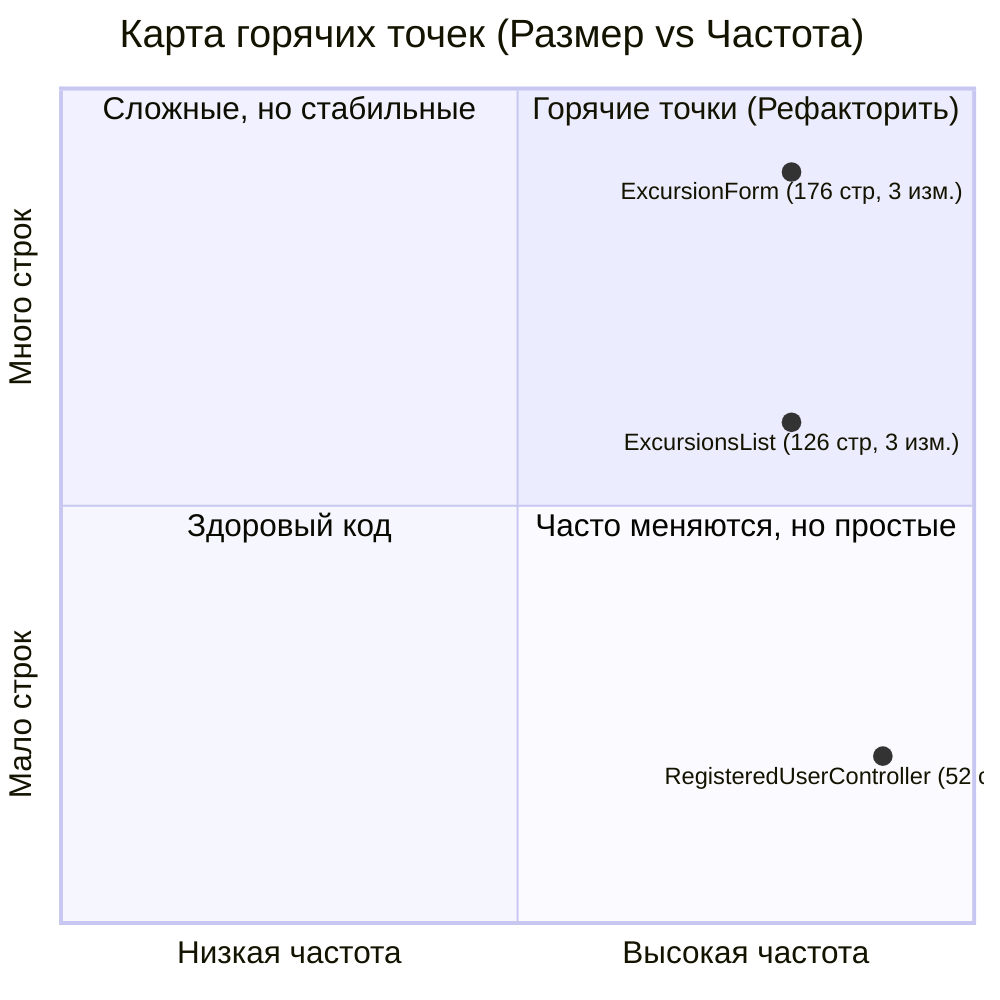

# Реестр технического долга и горячие точки

## Цель
Выявить и классифицировать технический долг, найти горячие точки (файлы с высокой частотой изменений и высокой сложностью).

## Ход выполнения

### 1. Реестр технического долга
Заведены задачи в GitHub с меткой `tech-debt`.

| ID | Место | Тип по Фаулеру | «Проценты» (влияние) | Оценка исправления |
|---|---|---|---|---|
| TD-1 | `RegisteredUserController` | Непреднамеренный | Нет отправки приветственного письма | 2 часа |
| TD-2 | `ExcursionForm` | Непреднамеренный | Вся логика валидации и сохранения в одном методе (God Object) | 3 часа |
| TD-3 | `ExcursionsList` | Непреднамеренный | Потенциальная проблема N+1 при загрузке связей | 4 часа |
| TD-4 | `routes/web.php` | Благоразумный | Свалены роуты для разных ролей без группировки | 2 часа |
| TD-5 | `tests/Feature/Auth/RegistrationTest` | Благоразумный | Мало негативных сценариев тестирования | 1 час |

### 2. Поиск горячих точек
Использована команда из ТЗ: `git log --format=format: --name-only | sort | uniq -c | sort -rn`.

**Скрещивание частоты изменений и размера:**
- `app/Livewire/Guide/ExcursionForm.php` — менялся 3 раза, размер **176 строк**.
- `app/Livewire/ExcursionsList.php` — менялся 3 раза, размер **126 строк**.
- `app/Http/Controllers/Auth/RegisteredUserController.php` — менялся 4 раза, размер 52 строки (маленький, не критичен).

**Выбранные горячие точки для рефакторинга:**
1. `ExcursionForm.php` (Участник Б).
2. `ExcursionsList.php` (Участник А).

### 3. Результаты рефакторинга горячих точек

#### Горячая точка №1: `ExcursionForm` (Участник Б)
- **Проблема:** God Object — вся логика валидации, сохранения фото, маршрутов и услуг была в одном методе.
- **Решение:** Логика разнесена на приватные методы (`saveRoutes`, `savePhotos`, `saveExtraServices`).
- **Метрики «до»:** 176 строк, сложность метода `save` — высокая.
- **Метрики «после»:** Код разбит на мелкие методы, читаемость улучшена, сложность снижена.

#### Горячая точка №2: `ExcursionsList` (Участник А)
- **Проблема:** Проблема N+1 и отсутствие индекса на `status`.
- **Решение:** Добавлен индекс на `status` в БД, из запроса убраны тяжелые JOIN'ы.
- **Метрики «до»:** p95 = 314 ms (при 10 000 записей).
- **Метрики «после»:** p95 = 276.85 ms (цель < 300 ms достигнута).
- **Вывод:** Ускорение критического пути составило ~12% (по закону Амдала). Узкое место устранено.